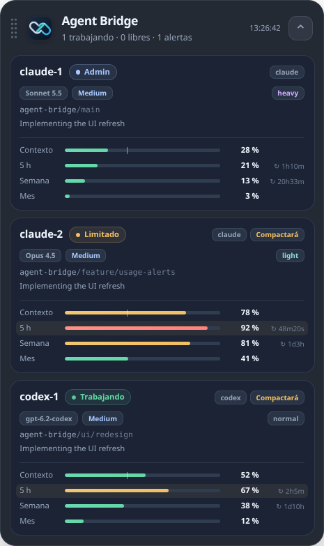

# Agent Bridge Widget

Widget de escritorio para Linux, macOS y Windows que muestra los estados, el contexto y las cuotas de todos los agentes del bridge. Consulta el dashboard cada 5 s por defecto y recalcula las cuentas atrás cada segundo.



## Instalación y uso

Con Node.js 22.12 o posterior y una sesión gráfica, ejecuta desde el directorio del widget:

```sh
npm install
npm start
```

Electron se instala con npm y prepara su binario automáticamente en el primer arranque. El widget utiliza las bibliotecas gráficas que ya trae el escritorio. La descarga inicial requiere internet. Durante el uso, el widget lee archivos locales y la salida del comando configurado.

Arrastra la ventana por el tirador del encabezado. Haz doble clic sobre el encabezado o pulsa la flecha para contraerla o expandirla. Cuando la lista supera el área de trabajo, puedes desplazarte dentro de la ventana. La bandeja permite mostrarla, ocultarla, alternar **Mostrar en la barra de tareas** (desactivado inicialmente) y **Siempre visible**, cambiar el intervalo entre 5, 10 y 30 s, la vista compacta, el orden, la opacidad y el tamaño de letra. La aplicación comparte una instancia por perfil de usuario y guarda las dimensiones, la posición y las preferencias en `widget.json` dentro del directorio de datos de Electron. El refresco se pausa al ocultar o minimizar la ventana y no solapa consultas.

| Acción | Linux y macOS | Windows |
| --- | --- | --- |
| Arrancar en segundo plano | `./bin/agent-bridge-widget start` | `.\bin\agent-bridge-widget.cmd start` |
| Consultar estado | `./bin/agent-bridge-widget status` | `.\bin\agent-bridge-widget.cmd status` |
| Cerrar | `./bin/agent-bridge-widget stop` | `.\bin\agent-bridge-widget.cmd stop` |

`start` puede omitirse y es idempotente. `npm start` trae al frente la ventana si ya existe. `status` devuelve 0 si está activo y 1 si está detenido. Los fallos operativos de los lanzadores devuelven 2. `stop` espera a que la instancia cierre y se puede repetir.

## Fuente de datos

En Linux y macOS el widget ejecuta `~/.claude-bridge/bin/agent dashboard --json`. Para usar otra fuente, asigna a `BRIDGE_WIDGET_CMD` la ruta de un ejecutable o de un script de Node.js (`.js`, `.cjs` o `.mjs`). El widget agrega los dos argumentos `dashboard` y `--json` e invoca la fuente directamente con `execFile`. Los scripts de Node se ejecutan con el binario de Electron en modo Node. Configura la variable antes de arrancar la instancia.

```sh
BRIDGE_WIDGET_CMD="/ruta/al/agent" npm start
```

En Windows configura la ruta de un ejecutable equivalente o de un script de Node que acepte esos argumentos y emita el mismo JSON por stdout. Ejemplo en PowerShell:

```powershell
$env:BRIDGE_WIDGET_CMD = 'C:\Bridge\agent.exe'
.\bin\agent-bridge-widget.cmd start
```

Para un adaptador de Node en Windows puedes usar una ruta como `C:\Bridge\agent-dashboard.cjs`. Si cambias la fuente, ejecuta `stop` y luego `start` para que la nueva instancia reciba el entorno actualizado. Si la fuente falla, supera los 10 s o devuelve datos inválidos, el widget conserva la última lectura, muestra **Sin conexión con el bridge** y reintenta.

## Límites por sistema

- **Linux.** El modo predeterminado es Wayland nativo. Usa `BRIDGE_WIDGET_X11=1` para forzar XWayland cuando `DISPLAY` está disponible. `skipTaskbar` sigue activo de forma predeterminada. El icono Agent Bridge se instala en PNG (512, 256, 128, 64 y 32 px) y SVG dentro de `~/.local/share/icons/hicolor`; el instalador crea `~/.local/share/applications/agent-bridge.desktop` con el nombre, app-id y `StartupWMClass` coherentes para que los docks puedan asociar la ventana con su icono. `Siempre visible`, el redimensionamiento y el reposicionamiento siguen dependiendo del compositor. [Ventanas en Wayland según Electron](https://www.electronjs.org/docs/latest/api/browser-window/#platform-notices).
- **macOS.** La aplicación oculta el Dock y usa la política de activación `accessory` para no aparecer como app normal en Dock/Cmd+Tab. El widget sigue disponible desde su icono de bandeja/barra de menús. El alcance de Siempre visible depende del Space activo y de las ventanas a pantalla completa.
- **Windows.** `skipTaskbar` y el tipo de ventana `toolbar` solicitan una ventana de herramienta, que se omite de la barra de tareas y Alt+Tab. No se pudo ejecutar una sesión Windows en este equipo Linux. La fuente debe configurarse con `BRIDGE_WIDGET_CMD`. Si el icono de bandeja se oculta, búscalo en el menú de iconos ocultos del área de notificación.

## Interfaz y rendimiento

La interfaz usa un tema oscuro acrílico y cambia a claro según `prefers-color-scheme`. La cabecera resume agentes trabajando, libres y con alertas. Cada tarjeta presenta el estado con chip semántico, modelo y esfuerzo, proyecto/rama, contexto con marca de referencia al 40 % y barras de uso de 5 h, semana y mes con umbrales de color y cuenta atrás. La vista compacta conserva una fila por agente; la detallada muestra métricas y detalles con tooltip. El scroll permanece dentro de la lista y el límite más alto se resalta cuando llega a 60 %. Las capturas de antes y después están en [before.png](docs/before.png) y [screenshot.png](docs/screenshot.png).

Para reducir consumo, Chromium limita el heap V8 a 128 MiB, la caché de disco a 1 MiB, desactiva corrector y extensiones y mantiene activo el throttling en segundo plano. Conservamos aceleración gráfica para compatibilidad con las ventanas transparentes en Wayland/X11.

### Mediciones locales

Antes: `agent dashboard --json` usaba 1,421 s de CPU de usuario y 1,447 s de sistema (2,868 s combinados; 2,424 s transcurridos). Después de calcular el tier con los datos ya leídos y reducir las invocaciones `jq` en `bridge-usage`, tres ejecuciones promediaron 1,01 s de CPU combinada y 0,85 s transcurridos. La comparación de tipos y rutas del JSON antes y después no mostró diferencias; los valores cambian entre capturas porque el estado y las cuotas siguen actualizándose.

La medición inicial del widget fue 7 procesos y unos 690 MiB. Después, `ps` observó 7 procesos, 640,4 MiB RSS agregado y 6,7 % de CPU agregado en reposo. El objetivo de menos de 0,3 s de CPU por consulta aún no se alcanza: se siguen analizando los archivos fuente en cada lectura. La muestra de CPU del widget es instantánea, no una media de largo plazo.

## Verificación

```sh
npm test
./bin/agent-bridge-widget stop
npm start -- --capture
```

Con el widget expandido y una fuente real disponible, el comando espera los datos, captura la ventana con `webContents.capturePage()`, guarda `docs/screenshot.png` y cierra la instancia. La integración con el bridge se describe en [INTEGRATION.md](INTEGRATION.md).
